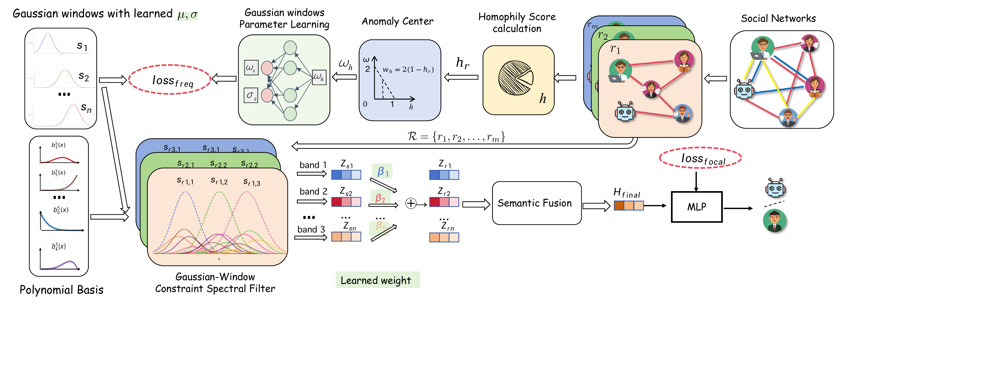
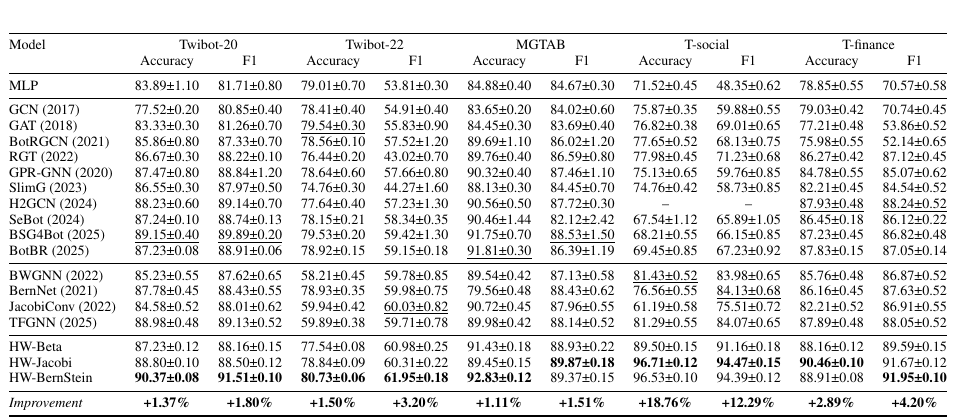

# HW-GNN: Homophily-Aware Bernstein Graph Network

[](https://github.com/)
[](https://www.dgl.ai/)

## Framework

<p align="center">
  
</p>

## Experiment Results

Table 1 reports the benchmark results for five datasets.

<p align="center">
  
</p>

## Installation

Use Python 3.10 or 3.11. For GPU training, use PyTorch and DGL builds that
support your CUDA environment.

```bash
python -m pip install -r requirements.txt
```

## Datasets

Download the benchmark data from the linked projects.

| Dataset | Source |
| --- | --- |
| TwiBot-20 | [TwiBot-20 repository](https://github.com/BunsenFeng/TwiBot-20) |
| TwiBot-22 | [TwiBot-22 repository](https://github.com/LuoUndergradXJTU/TwiBot-22) |
| MGTAB | [MGTAB repository](https://github.com/GraphDetec/MGTAB) |
| T-Social, T-Finance | [PyGOD data repository](https://github.com/pygod-team/data) |

By default, the loader reads prepared datasets from `dataset/raw`:

```text
dataset/raw/tfinance
dataset/raw/tsocial
dataset/raw/Twibot-20_raw/
dataset/raw/Twibot-22/graph.bin
dataset/raw/MGTAB/
```

`tfinance` and `tsocial` are DGL graph files. `Twibot-20_raw/` contains
`label.pt`, `edge_index.pt`, `edge_type.pt`, and the four feature tensors
`des_tensor.pt`, `tweets_tensor.pt`, `num_properties_tensor.pt`, and
`cat_properties_tensor.pt`. `MGTAB/` contains `features.pt`,
`edge_index.pt`, `edge_type.pt`, `labels_bot.pt`, and optional `edge_weight.pt`.

Place pretrained embeddings in `pretrained/`. The benchmark configurations
use `Twibot-20_pretrained_embedding_0.pt` for TwiBot-20 and
`MGTAB_pretrained_embedding_2.pt` for MGTAB. The MGTAB loader also accepts
`MGTAB/pretrained_embedding2.pt` under the data root. To generate PPR graphs for
T-Finance and T-Social, provide `tfinance_pretrained_embedding_0.pt` and
`tsocial_pretrained_embedding_0.pt`.

Set these variables to use other locations:

```bash
export BOT_DATA_ROOT=/path/to/raw-datasets
export BOT_CACHE_ROOT=/path/to/generated-graph-cache
export BOT_PRETRAINED_ROOT=/path/to/pretrained-artifacts
export BOT_MLP_ROOT=/path/to/mlp-checkpoints
```

## Reproducing the benchmarks

After preparing the data and embeddings, run the five benchmark configurations
in sequence:

```bash
bash run_best_reproduction_5datasets.sh
```

The script writes timestamped logs to `logs/` and summarizes the final test
metrics. To inspect a configuration without loading data, or to run a single
dataset:

```bash
python main.py --dataset tfinance --print_config
python -u main.py --dataset tfinance
```

For the MGTAB ensemble experiment, run:

```bash
bash run_mgtab_ensemble_optimization.sh
```

The script trains ten models on the same random split and evaluates ensembles
of their saved predictions.

## Repository map

- `main.py`: training and evaluation entry point.
- `config.py`: dataset-specific defaults.
- `dataset.py`: dataset loading and graph construction.
- `EnhancedBernsteinNet.py`: model and spectral convolution layers.
- `ppr.py`: optional PPR graph augmentation.
- `fixed_sota_configs.sh`: explicit shell arrays used by reproduction scripts.
- `analyze_mgtab_ensemble.py`: optional MGTAB probability-ensemble analysis.
- `table1.png`: the benchmark table shown in the paper.
